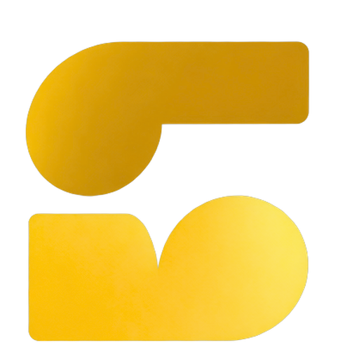

  

<h1 align="center">Soraivy</h1>

  <b>The creator-first Indian video platform.</b> 
  Videos, Shorts and live streams, built so small creators can grow and earn from day one.

  <a href="https://soraivy.com">Website</a> ·
  <a href="https://soraivy.com/blog">Blog</a> ·
  <a href="https://soraivy.com/help">Help Center</a> ·
  <a href="https://soraivy.com/about">About</a>

---

## Why Soraivy

Most platforms make new creators wait months before they can earn anything. Soraivy doesn't.

- **Earn from your first video.** Publish one public video, then apply to the Soraivy Partner Program.
- **Fair revenue share.** Partners keep 80% of the revenue from the ad banner under their videos and live streams, paid monthly.
- **Fair discovery.** SoraPulse, our recommendation engine, ranks videos on how viewers respond. Badges and payments can't buy reach.
- **Everything in one place.** Long videos, Shorts, live streaming, a creator Studio and a built-in browser video editor.

## Features

| | |
|---|---|
| 🎬 **Videos & Shorts** | Upload long-form videos and vertical Shorts |
| 🔴 **Live streaming** | Go live from your phone or with OBS |
| 🛠️ **Creator Studio** | Uploads, analytics, monetization and badges in one dashboard |
| ✂️ **FreeCut editor** | Edit videos right in your browser |
| ✅ **Channel badges** | Brand, Ambassador, Early Creator, Verified and Security badges, each reviewed by a person |
| 📱 **Everywhere** | Web, Android and iOS |

## Get started

- **Watch:** [soraivy.com](https://soraivy.com)
- **Create:** sign in, open Studio and upload your first video
- **Learn:** [Your first 30 days on Soraivy](https://soraivy.com/blog/your-first-30-days-on-soraivy)

## Contact

- Support and feedback: [soraivy.com/contact](https://soraivy.com/contact)
- Security issues: see [SECURITY.md](SECURITY.md)
- Follow us on [X](https://x.com/soraivy)

---

  © 2026 Soraivy. Operated in India by MERCURYAI INNOVATIONS INDIA PRIVATE LIMITED. 
  This repository holds no source code. Soraivy is proprietary software.

